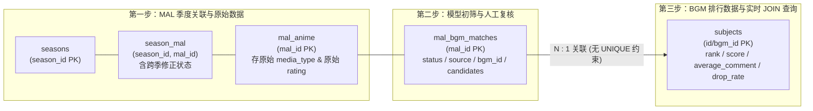

# 废弃 `season-data` 独立仓库并合入 `bgm-rank-api` 的架构与表结构设计

## 1. 核心问题与演进方向

在原有的 `season-data` 项目中，最大的痛点并非“跨仓库同步链路长”，而是**「审核与跨季调整过于复杂」**以及**「跨季/同季多对一映射导致的属性覆盖 Bug」**：
- MAL 上的季度归属经常存在标错季度的情况，且存在「不收录（韩漫、泡面番、CM、少儿动画、BGM 未建条目）」与「多对一映射（MAL 按季度拆成多个 `mal_id`，而 Bangumi 合并为一个 `bgm_id`）」的普遍现象。
- 原 `season-data` 将「季度归属 (`season_id`)」与「条目匹配审核 (`mal_id -> bgm_id`)」耦合在同一张 `season_items (season_id, mal_id)` 表中，并外挂 `overrides (add/skip)` 表来对抗 MAL 重抓。导致把一部番从错误季度挪到正确季度时，需要跨表写三条配对记录（源季 `exclude` + 源季 `override skip` + 目标季 `override add`）。
- 原 `bgm-rank-api` 将来自 MAL 的 `media_type` 与 `rating` 存成了 `subjects (bgm_id)` 表的全局唯一字段，导致跨季/同季同步时发生「后写覆盖（Last-Write-Wins）」，引發正片消失或番外串季霸榜（详见 [`docs/duplicate-subjects-analysis.md`](./duplicate-subjects-analysis.md)）。

**合入 `bgm-rank-api` 后的核心设计原则**：
将整个数据流严格拆解为正交的**三步走**，解耦「季度归属」与「条目匹配」，删除原有的 `season_subjects` 关联表，在查询时通过实时 JOIN、窗口函数优先级去重与字典映射输出排行榜数据。

---

## 2. 三步走数据流与最终数据库表结构



### 第一步：MAL 季度关联表与 MAL 原始表

第一步纯粹处理 MAL 侧的数据抓取，并直接在此层解决**「MAL 标错季度」**的问题：

#### 1. `seasons` 表（沿用现有表）
```sql
CREATE TABLE seasons (
    season_id   INTEGER PRIMARY KEY, -- 如 202601
    year        INTEGER NOT NULL,
    season      TEXT NOT NULL,       -- WINTER / SPRING / SUMMER / FALL
    name        TEXT,
    created_at  DATETIME NOT NULL,
    updated_at  DATETIME NOT NULL
);
```

#### 2. `mal_anime` 表（以 `mal_id` 为主键，存储 MAL 原始事实）
- **关键决策**：`rating` 字段**直接存储 MAL API 返回的原始值**（如 `"g"`, `"pg"`, `"pg_13"`, `"r"`, `"r+"`, `"rx"` 或 `NULL`），不在入库时降维成 `general/kids/r18`。如果将来调整分级映射口径，只需改代码中的映射字典，无需刷库。
- `media_type` 同样存储 MAL 原始值（`"tv"`, `"ona"`, `"ova"`, `"movie"`, `"tv_special"`, `"special"`, `"music"`, `"pv"`, `"cm"`, `"unknown"`）。
- **物理消除跨季覆盖 Bug**：由于 `media_type` 和 `rating` 绑定在 `mal_id` 上而非 `bgm_id` 上，当《至高之牌 第二季》的正片 (`202401`, `tv`) 与第 25 话番外 (`202410`, `ona`) 指向同一个 `bgm_id` 时，两个季度各自读取对应的 `mal_id`，物理上绝不会互相覆盖。

```sql
CREATE TABLE mal_anime (
    mal_id            INTEGER PRIMARY KEY,
    title             TEXT NOT NULL,
    title_ja          TEXT,
    title_en          TEXT,
    media_type        TEXT NOT NULL,  -- MAL 原始 media_type
    rating            TEXT,           -- MAL 原始 rating: g / pg / pg_13 / r / r+ / rx
    start_date        TEXT,
    end_date          TEXT,
    num_episodes      INTEGER,
    source            TEXT,           -- manga / light_novel / original ...
    studios           TEXT,           -- JSON array
    synopsis          TEXT,
    start_season_year INTEGER,
    start_season      TEXT,
    fetched_at        DATETIME NOT NULL
);
```

#### 3. `season_mal` 表（季度关联 `mal_id`，直接消化跨季标错问题）
用来记录「某季度包含哪些 `mal_id`」，彻底取代旧的 `overrides (add/skip)` 表：
- **MAL 自动抓取 (`fetch_mal`)**：使用 `INSERT INTO season_mal (season_id, mal_id, origin) VALUES (?, ?, 'mal') ON CONFLICT (season_id, mal_id) DO NOTHING`。
- **当发现 MAL 标错季度时（如把 `202601` 的番标到了 `202510`）**：
  - 在 `202510` 将该行标记为 `is_removed = 1`（由于行仍存在，`ON CONFLICT DO NOTHING` 保证下次重抓 `202510` 时绝不会复活）；
  - 在 `202601` 插入一行 `(202601, mal_id, origin = 'manual', is_removed = 0)`。

```sql
CREATE TABLE season_mal (
    season_id   INTEGER NOT NULL REFERENCES seasons(season_id) ON DELETE CASCADE,
    mal_id      INTEGER NOT NULL REFERENCES mal_anime(mal_id),
    origin      TEXT NOT NULL DEFAULT 'mal', -- 'mal' (抓取) | 'manual' (人工跨季移入/补番)
    is_removed  BOOLEAN NOT NULL DEFAULT 0,  -- 1 表示人工判定不属于本季（防重抓复活）
    note        TEXT,                        -- 跨季调整备注（如 "移至 202601"）
    created_at  DATETIME NOT NULL DEFAULT CURRENT_TIMESTAMP,
    PRIMARY KEY (season_id, mal_id)
);

CREATE INDEX idx_season_mal_active ON season_mal(season_id, is_removed);
```

---

### 第二步：匹配与审核表（`mal_id` 到 `bgm_id` 的映射）

由于第一步已经把季度归属剥离到了 `season_mal`，第二步的匹配与审核直接以 **`mal_id`** 为主键（与 `mal_anime` 1:1 对应，作为独立表 `mal_bgm_matches` 以确保写入边界物理隔离，让 `fetch_mal` 永远碰不到审核列）：

#### 4. `mal_bgm_matches` 表（模型初筛 + 人工复核）
- **全局唯一审核**：一个 `mal_id` 只需要匹配/审核一次。哪怕它在第一步中被从 `202510` 挪到了 `202601`，它的 `status` 和绑定的 `bgm_id` 自动跟随，**完全不需要重新审核**。
- **支持多对一（MAL 拆季 / BGM 合并）**：`bgm_id` **不加 `UNIQUE` 约束**。MAL 中分属不同季度的 Part 1 (`mal_id = 1001`) 和 Part 2 (`mal_id = 1002`)，或者同季的多个条目，都可以指向同一个 `bgm_id`。

```sql
CREATE TABLE mal_bgm_matches (
    mal_id      INTEGER PRIMARY KEY REFERENCES mal_anime(mal_id),
    status      TEXT NOT NULL DEFAULT 'pending' CHECK(status IN ('pending', 'included', 'excluded')),
    source      TEXT CHECK(source IN ('rule', 'exact', 'llm', 'human') OR source IS NULL),
    bgm_id      INTEGER REFERENCES subjects(id), -- 允许 N 个 mal_id 指向同一个 bgm_id
    confidence  REAL,
    candidates  TEXT,                            -- JSON: [{bgm_id, bgm_name, air_date, confidence, reason, conflicts}]
    reason      TEXT,                            -- 排除原因: not_on_bgm | kids | mini | merged_into_ep | not_anime | duplicate | other
    note        TEXT,                            -- 人工备注
    error       TEXT,                            -- 匹配管线异常记录
    updated_at  DATETIME NOT NULL
);

CREATE INDEX idx_matches_status ON mal_bgm_matches(status);
CREATE INDEX idx_matches_bgm_id ON mal_bgm_matches(bgm_id) WHERE bgm_id IS NOT NULL;
```

**四层匹配管线（`MatcherService`）在此表上的流转（含 `season-data/todo.md` 全部止血修正）**：
1. **已决策短路**：
   - 已是 `included` 或 `excluded` → 短路跳过（绝不覆盖人工或已确认决策；若 `status = 'included'` 且关联的 `subjects.last_updated_at IS NULL`，则顺手补拉 Bangumi 详情）。
   - `status = 'pending'` 且 `source IS NOT NULL`（代表已被 LLM 处理过但未达阈值或判无匹配）→ 除非显式传入 `retry = true`，否则短路跳过，避免重复消耗 Token 与 Bangumi 搜索请求。
2. **第一层：媒体类型与语言规则过滤 (`source = 'rule'`)**：
   - `media_type` 属于 `pv` / `cm` / `music` / `special` / `tv_special` / `unknown`（源头直接拦截 `unknown`）→ 直接 `status = 'excluded', source = 'rule'`。
   - **韩文语言护栏（掐 LLM、保 Exact）**：纯谚文标题（含谚文 `[가-힣]` 且不含日文假名，`is_korean_title`）只允许走日文/原文精确匹配；若精确匹配未命中，**不调用 LLM**，直接 `status = 'excluded', source = 'rule'`。（注：绝不对中文/汉字标题设护栏，避免误杀国产动画与全汉字日漫）。
3. **第二层：Bangumi 多级降级搜索 (`_search_bgm`)**：
   - 按顺序尝试：`带季度日期范围搜索` → `不带日期范围搜索` → `正则剥离后缀（第N期、Season N、劇場版、～副标题～ 等）后重试` → `调用 LLM suggest_search 获取搜索词`。
4. **第三层：日文标题精确匹配 (`source = 'exact'`)**：
   - Bangumi 搜索结果中 NFKC 归一化标题相等，**且同样通过 `match_conflicts` 硬规则检查**（日期差 $\le 6$ 个月、平台不互斥）：
     - 无冲突 → `status = 'included', source = 'exact', confidence = 1.0`；
     - 命中冲突（如同名重制版或同名剧场版）→ 降级为 `status = 'pending', source = 'exact'` 交人工复核。
5. **第四层：LLM 语义匹配 (`source = 'llm'`)**：
   - 调用 DeepSeek / OpenRouter 打分（`max_tokens >= 1024`，防止推理模型的 `reasoning_tokens` 截断输出 JSON）：
   - 若 `confidence >= 0.85` 且通过本地 `match_conflicts` 硬规则 → `status = 'included', source = 'llm'`，并立即调用 `hydrate_subject` 拉取该 `bgm_id` 的排行与剧集数据；
   - 若置信度不足、命中硬规则冲突或模型认为均不匹配 → **统一写入 `status = 'pending', source = 'llm'`**（确保步骤 1 的短路生效，且前端能明确区分「未跑过 (`source IS NULL`)」与「LLM 判无匹配 (`source = 'llm'`)」）。
   - 收尾兜底：若上述全部未命中且该条目为 `media_type == 'ona'` 且 `rating IN ('g', 'pg')` (`is_hopeless_ona_kids`) → 直接 `status = 'excluded', source = 'rule', reason = 'kids'`。

---

### 第三步：BGM 条目表与实时 JOIN 查询（与现有项目衔接）

#### 5. 删除 `season_subjects` 表，升级 `subjects` 表
- **废弃 `season_subjects`**：不再维护冗余的 `(season_id, bgm_id)` 关联表，彻底消灭 `reconcile_all` 对账逻辑。
- **`subjects` 表移除 `media_type` 和 `rating` 列**（这两个维度完全由 `mal_anime` 提供），并补充匹配与冲突校验所需的 Bangumi 原始字段（`air_date`, `platform`, `summary`, `tags`, `nsfw`）：

```sql
CREATE TABLE subjects (
    id                INTEGER PRIMARY KEY, -- bgm_id
    name              TEXT,
    name_cn           TEXT,
    air_date          TEXT,                -- BGM 放送开始日期 (YYYY-MM-DD)
    platform          TEXT,                -- TV / WEB / OVA / 剧场版 ...
    summary           TEXT,
    tags              TEXT,                -- JSON array
    nsfw              BOOLEAN,
    images_grid       TEXT,
    images_large      TEXT,
    rank              INTEGER,
    score             REAL,
    collection_total  INTEGER,
    average_comment   REAL,
    drop_rate         REAL,
    air_weekday       TEXT,
    meta_tags         TEXT NOT NULL DEFAULT '[]', -- JSON array
    updated_at        DATETIME NOT NULL,
    last_updated_at   DATETIME             -- NULL 表示仅插入了 ID 的骨架行，待拉取详情
);
```

#### 6. 公开查询 (`QueryService`)：实时 JOIN + 优先级去重 + `rating` 字典映射

为彻底解决 [`docs/duplicate-subjects-analysis.md`](./duplicate-subjects-analysis.md) 中指出的**「同季重复 `bgm_id` 属性优先级」**与**「跨季番外抢占季度 Top 1 封面」**两个问题，公开接口 SQL 设计如下：

1. **获取某季度番剧排行榜 (`GET /api/seasons/{season_id}/subjects`)**：
   - 从 `season_mal` $\rightarrow$ `mal_bgm_matches` $\rightarrow$ `mal_anime` $\rightarrow$ `subjects` 四表关联查询，筛选 `is_removed = 0` 且 `status = 'included'` 的记录。
   - **同季同 `bgm_id` 按 `media_type` 优先级归并去重**：使用 `ROW_NUMBER() OVER (PARTITION BY s.id ...)` 窗口函数，当同季内有多个 `mal_id`（例如一部正片 `tv` 和一部先行 `ona`）指向同一 `bgm_id` 时，严格按 **`tv > movie > ova > ona > 其他`**（同优先级按 `mal_id ASC`）选取主条目的 `media_type` 与 `rating`：

   ```sql
   SELECT
       id, name, name_cn, images_grid, images_large,
       rank, score, collection_total, average_comment,
       drop_rate, air_weekday, meta_tags,
       media_type, raw_mal_rating
   FROM (
       SELECT
           s.id, s.name, s.name_cn, s.images_grid, s.images_large,
           s.rank, s.score, s.collection_total, s.average_comment,
           s.drop_rate, s.air_weekday, s.meta_tags,
           m.media_type,
           m.rating AS raw_mal_rating,
           ROW_NUMBER() OVER (
               PARTITION BY s.id
               ORDER BY CASE m.media_type
                   WHEN 'tv' THEN 1
                   WHEN 'movie' THEN 2
                   WHEN 'ova' THEN 3
                   WHEN 'ona' THEN 4
                   ELSE 5
               END ASC, m.mal_id ASC
           ) AS rn
       FROM season_mal sm
       JOIN mal_bgm_matches mbm ON mbm.mal_id = sm.mal_id
       JOIN mal_anime m         ON m.mal_id = sm.mal_id
       JOIN subjects s          ON s.id = mbm.bgm_id
       WHERE sm.season_id = ?
         AND sm.is_removed = 0
         AND mbm.status = 'included'
   )
   WHERE rn = 1
   ORDER BY rank ASC NULLS LAST
   ```

2. **获取各季度第一名番剧 (`GET /api/seasons/top1`)**：
   - **限定 `tv` + `general` 资格**：在选取每个季度的门面 Top 1 番剧时，显式限制 `m.media_type = 'tv'` 且原始 `rating` 属于全年龄段（即排除 `g`, `pg`, `r+`, `rx`），防止往季高分正片因在新季度播出一集番外 ONA/OVA 而抢走新季度的 Top 1 封面：

   ```sql
   SELECT season_id, id, name, name_cn, images_grid, images_large,
          rank, score, collection_total, average_comment,
          drop_rate, air_weekday, meta_tags, media_type, raw_mal_rating
   FROM (
       SELECT sm.season_id,
              s.id, s.name, s.name_cn, s.images_grid, s.images_large,
              s.rank, s.score, s.collection_total, s.average_comment,
              s.drop_rate, s.air_weekday, s.meta_tags,
              m.media_type,
              m.rating AS raw_mal_rating,
              ROW_NUMBER() OVER (
                  PARTITION BY sm.season_id
                  ORDER BY s.rank ASC NULLS LAST, s.collection_total DESC NULLS LAST
              ) AS rn
       FROM season_mal sm
       JOIN mal_bgm_matches mbm ON mbm.mal_id = sm.mal_id
       JOIN mal_anime m         ON m.mal_id = sm.mal_id
       JOIN subjects s          ON s.id = mbm.bgm_id
       WHERE sm.is_removed = 0
         AND mbm.status = 'included'
         AND m.media_type = 'tv'
         AND COALESCE(m.rating, '') NOT IN ('g', 'pg', 'r+', 'rx')
   )
   WHERE rn = 1
   ORDER BY season_id DESC
   ```

3. **`rating` 映射字典转换（Rust 代码层）**：
   数据库中存的是 MAL 原始 `rating`，在 `QueryService` 组装 `PublicSubjectItem` 响应时，通过映射字典实时转换为前端所需的 `general` / `kids` / `r18`：

   ```rust
   pub fn map_mal_rating(raw_rating: Option<&str>) -> &'static str {
       match raw_rating {
           Some("g") | Some("pg") => "kids",
           Some("r+") | Some("rx") => "r18",
           // "pg_13", "r", None 或其他值统一归为 general
           _ => "general",
       }
   }
   ```

4. **定时调度器 (`SchedulerService`) 无缝衔接**：
   调度器不再跑 `reconcile_all`，每次 Tick 直接通过 `season_mal` + `mal_bgm_matches (status = 'included')` 查出所有在榜的 `(season_id, bgm_id)`（取每个 `bgm_id` 所属的**最新季度 `MAX(season_id)`** 计算 `age`），按季度距离刷新到期的 `subjects` 评分、排名与剧集评论均值，随后触发 Deploy Hook。

---

## 3. 历史数据无损迁移与备份方案

将现有 `../season-data` 的数据一次性迁入 `bgm_rank.db` 时，需注意 `season-data` 的历史结构是以 `(season_id, mal_id)` 为粒度的：

1. **一次性迁移步骤**：
   - **`seasons`**：将 `season-data` 中的 `"2026-winter"` 格式通过 `season_key_to_id` 转换为 `202601` 写入 `seasons`。
   - **`mal_anime`**：从 `season-data/season.db` 的 `mal_anime` 表直接导入全部 MAL 元数据；对于 `rating` 字段，若原库已降维，可通过 `data/mal/*.json` 原始抓取缓存（或 `backfill`）还原 MAL 原始 `rating` 值（`g`/`pg`/`pg_13`/`r`/`r+`/`rx`）。
   - **`season_mal`**：
     - 将原 `season_items` 中的 `(season_id, mal_id, origin)` 导入 `season_mal`（`origin = 'override'` 映射为 `'manual'`）；
     - 将原 `overrides` 中 `action = 'skip'` 或 `reason = 'wrong_season'` 的记录在对应季度的 `season_mal` 中标记为 `is_removed = 1`。
   - **`mal_bgm_matches`**：
     - 将原 `season_items` 的匹配决策按 `mal_id` 归并导入 `mal_bgm_matches`（若同一 `mal_id` 在多个季度出现，优先保留 `status = 'included'` 或 `source = 'human'` 的决策行）。
2. **不可重建资产的版本化备份（承接 `decisions.jsonl`）**：
   - 提供 CLI 子命令或管理接口导出两个极简 Git 追踪文件：
     - `data/season_mal.jsonl`：记录所有人工干预过的季度归属变更（`origin = 'manual'` 或 `is_removed = 1` 的行）。
     - `data/matches.jsonl`：按 `mal_id` 升序导出 `mal_bgm_matches` 的决策列（`mal_id, status, source, bgm_id, confidence, reason, note`），保持行级 `git diff` 能力。

---

## 4. 新架构下常见审核场景与旧版对比

| 场景 | 旧 `season-data` + `bgm-rank-api` 的问题 | 新三步表结构下的表现 |
| :--- | :--- | :--- |
| **MAL 标错季度**<br>（如把 `202601` 新番标到了 `202510`） | 需写 3 条记录：`2025-fall` 标 `excluded/wrong_season` + `overrides` 插 `skip` + `2026-winter` 插 `add`；到新季度还得重绑 `bgm_id`。 | 仅改 `season_mal`：`202510` 设 `is_removed = 1`，`202601` 插入 `(202601, mal_id, 'manual')`。`mal_bgm_matches` 里的 `bgm_id` 绑定关系原封不动直接生效。 |
| **跨季正片与番外共用 `bgm_id`**<br>（如《至高之牌 2》`202401` TV + `202410` 番外 ONA） | `subjects.media_type` 被后同步的 `202410` 覆盖为 `ona`，导致 `202401` 正片在默认 TV 榜单中凭空消失。 | `media_type` 存于各自的 `mal_anime (mal_id)` 行中，互不干扰。且审核 `202410` 番外时，前端提示该 `bgm_id` 已被 `202401` 正片占用，可一键标为 `excluded (reason='merged_into_ep')`。 |
| **MAL 分割多季正片，BGM 仅单个条目**<br>（如《章鱼哔》或 Part 1 / Part 2 指向同一 `bgm_id`） | 若同季内有多个 `mal_id` 指向同一 `bgm_id`，后写者覆盖属性。 | `mal_bgm_matches` 允许 N:1 指向同一 `bgm_id`；查询层通过窗口函数按 `tv > movie > ova > ona` 优先级自动去重。 |
| **修改分级映射规则**<br>（如调整 `pg` 或 `r` 的归类） | `mal_anime.rating` 入库时已降维写死，改规则需全库重拉或写 SQL 迁移。 | `mal_anime.rating` 存原始值 (`g`/`pg`/`pg_13`/`r`/`r+`/`rx`)，只需修改 Rust 的 `map_mal_rating` 字典函数即可全局生效。 |
| **人工审核通过一条 `pending`** | 改 `season.db` → 导出 JSONL → 发布 GitHub Release → 等 `bgm-rank-api` 对账。 | `PATCH /admin/matches/{mal_id}` 设 `status = 'included', bgm_id = X` → 立即触发 `hydrate_subject(X)`，前端排行榜毫秒级生效。 |

---

## 5. 本地管理前端设计 (`admin`)

管理前端定位为**仅在本地运行的轻量级纯 SPA 工作台**（支持一键切换连接本地 `localhost:3000` 开发后端与 Fly.io 生产后端），详细视觉规范、组件架构与键盘流交互设计请参见：
- [本地管理工作台前端设计规范 (`docs/admin-frontend-design.md`)](./admin-frontend-design.md)
